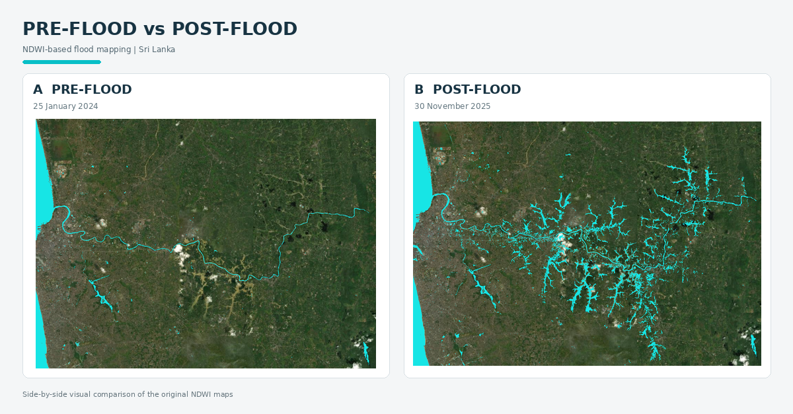
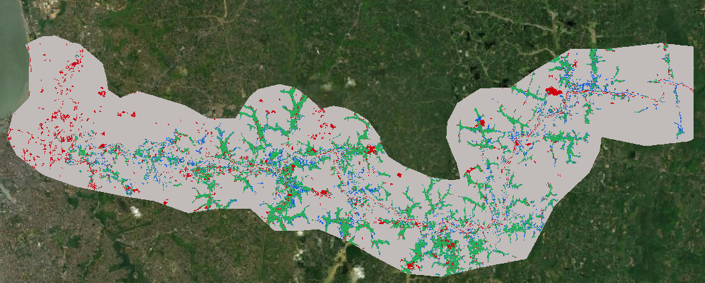

# Flood Mapping of Cyclone Ditwah (Sri Lanka, 2025) with Sentinel-2 NDWI
**[Open the interactive map](https://misba-pk.github.io/srilanka-flood-mapping/web/)**



Mapping and validating the flood extent along the **Kelani Ganga river (Colombo / Gampaha)** after Cyclone Ditwah, using free Sentinel-2 imagery, NDWI, pre-flood change detection and simple morphological post-processing. The result is validated against the official **Copernicus EMS** flood delineation.

**Final result: IoU 0.62 · F1 0.77 · precision 0.77 · recall 0.77** (mapped flood 33.4 km² vs. 33.7 km² in the reference)


*Green = agreed, red = only this map, blue = missed (reference: Copernicus EMS EMSR851)*

## Event and Study Area

- **Event:** Cyclone Ditwah made landfall on Sri Lanka's east coast on 28 November 2025 and caused the country's worst flooding in over 20 years, affecting all 25 districts. Gampaha, Colombo and Puttalam were among the hardest hit.
- **Area:** Kelani Ganga floodplain, Western Province (Copernicus EMS EMSR851, AOI02), 230 km² evaluated
- **CRS:** WGS 84 / UTM zone 44N (EPSG:32644)

## Data

| Data | Details |
|---|---|
| Post-flood image | Sentinel-2B L2A, **30 Nov 2025, 05:00 UTC**, tile T44NLN |
| Pre-flood image | Sentinel-2 L2A, **25 Jan 2024**, same tile (dry season; matches the EMS pre-event reference date) |
| Bands | B03 Green, B08 NIR (10 m) |
| Reference | Copernicus EMS **EMSR851 AOI02 Kelani Ganga – Delineation** (situation 30 Nov 2025) |

The EMS delineation was derived from PlanetScope imagery (3.9 m) acquired on 30 Nov 2025 at 05:39 UTC, about 40 minutes after the Sentinel-2 acquisition, with ESRI World Imagery (24 Jan 2024) as the pre-event reference.

## Methodology

1. **NDWI** with the L2A offset correction (processing baseline ≥ 04.00):
   `NDWI = ((B03 - 1000) - (B08 - 1000)) / ((B03 - 1000) + (B08 - 1000))`
2. **Water mask:** post-flood `NDWI > -0.10`.
3. **Permanent water removal:** pixels that are water in the pre-flood image (`NDWI > 0`) are removed, so only new water counts as flood.
4. **Post-processing:** morphological closing (3×3) to fill small holes and gaps, then removal of flood patches smaller than 25 pixels (2,500 m²).
5. **Validation:** the EMS flood polygons and area of interest are rasterised to the same 10 m grid; IoU, F1, precision and recall are computed inside the EMS area.
6. **Experiments:** 80 combinations (with/without permanent water removal × 5 thresholds × closing on/off × 4 minimum patch sizes).

## Results

**Contribution of each step** (pre-flood image Jan 2024, threshold -0.10 unless stated):

| Setup | IoU | F1 | Precision | Recall | Flood area |
|---|---|---|---|---|---|
| NDWI > 0 only | 0.501 | 0.668 | 0.730 | 0.616 | 28.4 km² |
| + permanent water removal | 0.558 | 0.717 | **0.860** | 0.614 | 24.0 km² |
| + threshold -0.10 | 0.588 | 0.740 | 0.765 | 0.717 | 31.5 km² |
| + remove patches < 25 px only | 0.589 | 0.741 | 0.810 | 0.684 | 28.4 km² |
| + closing only | 0.614 | 0.761 | 0.743 | **0.780** | 35.3 km² |
| **+ closing + remove patches < 25 px (final)** | **0.622** | **0.767** | 0.770 | 0.765 | 33.4 km² |

**Threshold sweep** (IoU, with closing off):

| Pre-flood removal | 0 | -0.05 | -0.10 | -0.15 | -0.20 |
|---|---|---|---|---|---|
| none | 0.501 | 0.520 | 0.531 | 0.530 | 0.519 |
| Jan 2024 | 0.558 | 0.579 | **0.588** | 0.583 | 0.567 |

Full results for all experiments: `results/results.csv`.

**Key findings**
- **Removing permanent water** (river, sea, lagoons) cut false positives by 56% (7.7 → 3.4 km²).
- **The best threshold is -0.10**, and IoU stays within 0.579–0.588 between -0.05 and -0.15, so the result does not hinge on an exact threshold.
- **Closing and small-patch removal complement each other:** closing recovers missed flood inside flooded areas (recall 0.72 → 0.78), patch removal removes isolated false detections (precision 0.77 → 0.81); together they balance precision and recall at 0.77.
- **An elevation mask was also tested** (Copernicus DEM GLO-30, limits of 10–30 m) and gave no meaningful gain (+0.004 IoU), as the study area is a flat, low-lying floodplain, so it was left out of the method.
- **The L2A offset matters for non-zero thresholds:** without it, NDWI values are compressed towards 0 and thresholds lose their standard meaning.

## How to Reproduce

1. Download the data and put these files in `data/`:
   - Sentinel-2 L2A, tile T44NLN, from the [Copernicus Data Space Ecosystem](https://dataspace.copernicus.eu): bands **B03** and **B08** (10 m) of the 30 Nov 2025 and 25 Jan 2024 scenes, found in `GRANULE/*/IMG_DATA/R10m/` of each product
   - **EMSR851 AOI02 Delineation** vector product from [Copernicus EMS](https://mapping.emergency.copernicus.eu/activations/EMSR851): the `observedEventA` and `areaOfInterestA` shapefiles (`.shp`, `.shx`, `.dbf`, `.prj`)

   ```
   data/
   ├── postflood_202511/
   │   ├── T44NLN_20251130T050049_B03_10m.jp2
   │   └── T44NLN_20251130T050049_B08_10m.jp2
   ├── preflood_202401/
   │   ├── T44NLN_20240125T050101_B03_10m.jp2
   │   └── T44NLN_20240125T050101_B08_10m.jp2
   └── EMS/
       ├── EMSR851_AOI02_DEL_PRODUCT_observedEventA_v1.shp (+ .shx .dbf .prj)
       └── EMSR851_AOI02_DEL_PRODUCT_areaOfInterestA_v1.shp (+ .shx .dbf .prj)
   ```
2. Run:
   ```bash
   pip install -r requirements.txt
   python run_experiments.py   # experiments -> results/
   python make_webmap.py       # GeoJSON layers for the web map -> web/data/
   ```
3. Outputs: `results/results.csv`, `results/flood_final.tif`, `results/compare_final.tif`, and the interactive map in `web/` (preview with `python -m http.server`, then open `localhost:8000/web/`).

## Limitations

- All settings were selected on the same EMS reference used for evaluation, so the scores are somewhat optimistic; the method has not yet been tested on a second area.
- The reference is based on 3.9 m PlanetScope imagery, while this analysis uses 10 m Sentinel-2; narrow flooded features and flood edges become mixed pixels at 10 m, so part of the remaining disagreement is a resolution effect.
- Post-flood clouds were not masked; optical imagery cannot see water under cloud or tree canopy. Sentinel-1 SAR would address both.
- About 1.7 km of the EMS area lies beyond the edge of tile T44NLN and is excluded.

## Credits

- Contains modified Copernicus Sentinel data (2024, 2025), processed by ESA. Reference flood extent © Copernicus Emergency Management Service (EMSR851).
- McFeeters, S. K. (1996). The use of the Normalized Difference Water Index (NDWI) in the delineation of open water features. *International Journal of Remote Sensing*, 17(7), 1425–1432.